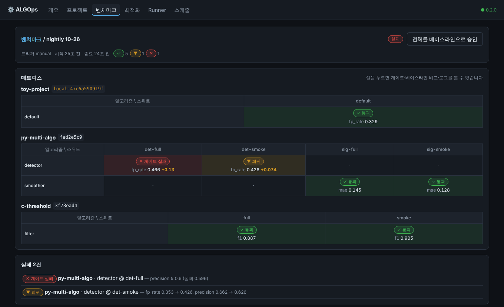
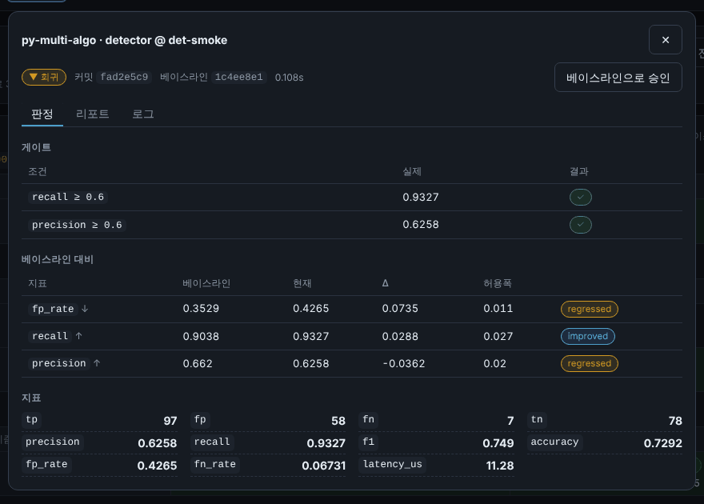
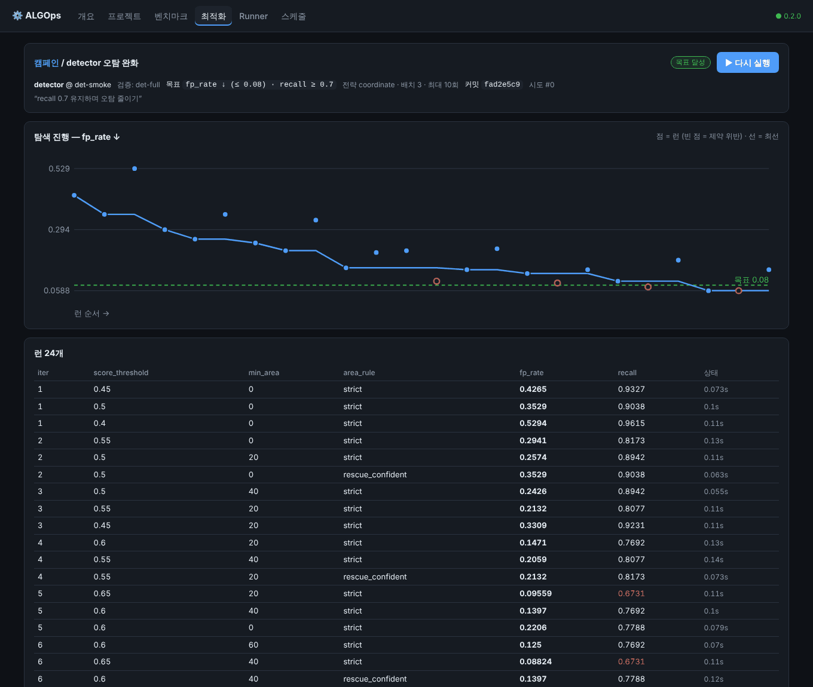
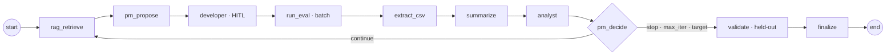
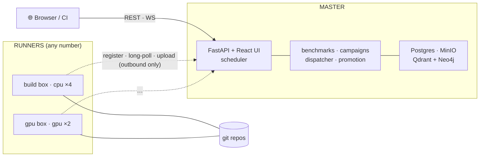

<div align="center">

# ⚙️ ALGOps

**Test, benchmark and tune every algorithm in every repository — in any language.**

[](https://www.python.org/)
[](https://github.com/langchain-ai/langgraph)
[](https://fastapi.tiangolo.com/)
[](https://react.dev/)


[Why](#-why) · [Quick start](#-quick-start) · [Onboard a repo](#-onboard-a-repository) · [Benchmarks](#-benchmarks--regressions) · [Campaigns](#-optimization-campaigns) · [Deploy](#-deployment) · [Docs](#-docs)

<br/>



<sub>A benchmark across three repositories (Python, C, and the bundled toy). A commit that lowered a threshold shows up as a regression on one suite and a failed gate on another. (UI is Korean — an on-prem tool for a Korean team.)</sub>

</div>

---

## 💡 Why

Classic MLOps tracks *training hyper-parameters → model quality*. ALGOps works on the layer around
the model — the **post-processing and decision algorithms** (thresholds, shape filters, debouncing,
smoothing windows, NMS modes …) that teams tune by hand, scattered across many repositories and
languages.

ALGOps gives all of them one contract and one engine:

- **Any language.** An algorithm is any program that reads `request.json` and writes `result.json`.
  Python gets a zero-dependency SDK; C, Go, Rust, MATLAB or a shell script work as-is.
- **Every algorithm × every test suite.** One `algops.yaml` per repository declares *N* algorithms,
  *M* suites, their parameters, metrics, gates and objectives.
- **Git is the source of truth.** Every run is pinned to a commit. Defaults live in the repo; the
  best parameters found are *proposed* back as a branch commit / PR — never applied silently.
- **Parameters only.** Agents explore the declared parameter space. Code is never modified.
- **Verdicts in code, not in the LLM.** Gates, regressions, stop conditions and notifications are
  deterministic; LLM agents only propose, analyze and summarize.

## ✨ What you get

| | |
| --- | --- |
| 🧪 **Benchmarks** | Run the full project × algorithm × suite matrix at pinned commits. Each cell: **absolute gates** (`recall >= 0.85`) then **baseline comparison** with tolerance → `passed / improved / regressed / gate_failed / error`. Regressions keep failing until fixed or explicitly accepted. |
| 🎯 **Campaigns** | Multi-parameter search (coordinate / random / grid) with **constraints** (*minimize fp_rate s.t. recall ≥ 0.9*), parallel **batches**, held-out **validation suites** to catch over-fitting, optional LLM planner + RAG memory, human-in-the-loop approval. |
| 🌿 **Promotion** | One click writes the winning defaults on a new branch at the campaign's commit — byte-minimal, comment-preserving diff — pushes it, and opens a GitHub/GitLab PR. |
| 🛰️ **Runners** | Outbound-only workers on any machine (NAT friendly). Each serves many repos: git mirror + per-commit worktrees, cached `env.setup`, labels (`gpu`, `cuda12`), concurrency, re-dispatch when a runner dies. |
| ⏰ **Triggers** | UI, cron schedules, **git watch** (new commit on the default branch → benchmark), `algops ci` for any CI system, and `algops test` inside the repo itself (no master needed). |
| 📊 **Telemetry** | Per-stage CSVs joined on an `entity_id` spine; the master recomputes the confusion matrix independently and attributes drops to parameters. |

## 🚀 Quick start

No Docker, no GPU.

```bash
uv sync
uv run pytest                                   # 113 tests, no external services

uv run algops test examples/py-multi-algo       # 2 algorithms × 2 suites each, gates applied
uv run algops test examples/c-threshold         # a C program compiled by env.setup
```

Run the platform locally (master + a runner):

```bash
uv run algops master                                              # http://127.0.0.1:8000
ALGOPS_SLAVE_MASTER_URL=http://127.0.0.1:8000 uv run algops slave  # serves the bundled toy project
```

Open the UI → **프로젝트** → register any git URL the runner can clone → **▶ 벤치마크**.

## 🔌 Onboard a repository

```bash
cd your-repo
algops init -a detector            # algops.yaml + params + entrypoint + sample suite + AGENTS.md
algops validate                    # static checks
algops run -a detector -s smoke --set detector.confidence_threshold=0.6
algops verify                      # every algorithm runs with its defaults — must exit 0
algops test --json baseline.json   # the full matrix + gates; later: --baseline baseline.json
```

Or hand the repository to a coding agent (Claude Code / Codex): `algops init` ships an
[`AGENTS.md`](src/algops/contract/bundle/AGENTS.md) / `CLAUDE.md` contract that tells it how to
externalize hard-coded constants **without changing behavior**, gated by `algops verify`.

```yaml
# algops.yaml
algops: 2
env:
  setup: ["make build"]                       # once per commit, cached by the runner
suites:
  - { id: smoke, uri: data/smoke, tags: [fast] }
  - { id: full,  uri: "${DATASETS}/vision/full" }   # expanded on each runner host
algorithms:
  - id: detector
    params: algops/detector/params.yaml
    entrypoint: { command: ["./build/eval"] }       # or { python: "algops/detector/run.py:run" }
    metrics:    { presets: [binary], declare: [{ name: latency_ms, direction: minimize }] }
    gates:      [{ metric: recall, op: ">=", value: 0.85 }]
    objective:  { metric: fp_rate, target: 0.05, constraints: [{ metric: recall, op: ">=", value: 0.85 }] }
    runs_on:    [gpu]
```

The program reads its parameters from `ALGOPS_PARAM_<KEY>`, `$ALGOPS_PARAMS_FILE` or
`$ALGOPS_REQUEST`, the suite from `ALGOPS_SUITE_PATH`, and writes
`{"status":"ok","metrics":{…},"counts":{"tp":…}}` to `$ALGOPS_RESULT`.
Full reference (Korean): **[docs/contract-v2.md](docs/contract-v2.md)**.

## 🧪 Benchmarks & regressions

```text
sync each repo (ref → sha, manifest) → expand cells → dispatch in parallel across runners
  → per cell: gates, then compare to the last accepted result → verdict → summary + notification
```

<div align="center">

</div>

- **Baseline** = the most recent *accepted* evaluation of the same cell (passed/improved, or a cell
  a human accepted as an intentional trade-off).
- **Tolerance** = `max(abs_tolerance[metric], rel_tolerance × |baseline|)`, per algorithm.
- `algops ci --master … --project vision --ref $SHA` blocks a merge on the master's verdict;
  `algops test --baseline main.json` does the same with no master at all.

## 🎯 Optimization campaigns

<div align="center">

</div>

A LangGraph supervisor loop pinned to one commit:



- Iteration 1 always evaluates the repository's current defaults.
- Ranking is **feasibility first**, then constraint violation, then the objective.
- The router enforces `max_iteration` and the target — an agent cannot talk past them.
- `validate` re-runs the winner *and* the defaults on held-out suites and flags over-fitting.
- Every re-run is a new **attempt** with a clean checkpoint thread.

## 🏗️ Architecture



```
src/algops/
  core/        contract: manifest, metrics/objectives, params, wire schemas, settings
  sdk/         zero-dependency Python SDK (algops_sdk.py), injected into every run
  runner/      run protocol, git workspaces, env setup, promotion, local `algops test`
  slave/       the runner process (register · heartbeat · workers · uploads)
  search/      deterministic strategies (coordinate · random · grid)
  agents/      LangGraph campaign loop
  extraction/  telemetry aggregation, reports, verdicts
  master/      API, dispatcher, command bus, services (benchmarks · campaigns · promotion · scheduler)
  tracking/    ORM, repositories, artifact stores   (+ alembic/ migrations)
  rag/ llm/ notify/   cross-experiment memory, LLM planner, deterministic notifications
frontend/      React + TS + Vite UI → built into src/algops/master/static/ui
examples/      py-multi-algo (Python, 2 algorithms), c-threshold (C)
```

## 🚢 Deployment

```bash
# server A — Postgres + Redis + MinIO + Qdrant + Neo4j + Celery + Traefik
ALGOPS_ENROLL_TOKEN=<secret> ALGOPS_API_TOKEN=<secret> \
  docker compose -f deploy/docker-compose.full.yml up -d --build

# any machine that should execute runs (outbound HTTP only)
ALGOPS_MASTER_URL=http://<A_IP>:8000 ALGOPS_ENROLL_TOKEN=<secret> \
ALGOPS_RUNNER_LABELS=gpu,cuda12 ALGOPS_RUNNER_CONCURRENCY=2 \
  docker compose -f deploy/docker-compose.slave.yml up -d
```

Details (runner settings, datasets, private repos, PR providers, migrations):
**[docs/deployment.md](docs/deployment.md)**.

## 📚 Docs

Detailed docs are in Korean (the team's working language):

- [docs/contract-v2.md](docs/contract-v2.md) — `algops.yaml`, the run protocol, the SDK, telemetry, CLI
- [docs/architecture.md](docs/architecture.md) — principles, dispatch, benchmarks, the campaign loop, promotion
- [docs/master-slave-protocol.md](docs/master-slave-protocol.md) — runner protocol + REST API
- [docs/deployment.md](docs/deployment.md) — dev, Docker, production, runners, CI

## 📜 License

Not yet specified — please open an issue or contact the maintainer before reuse.

<div align="center"><sub>Built with FastAPI · LangGraph · React. 🤖 Co-developed with Claude.</sub></div>
