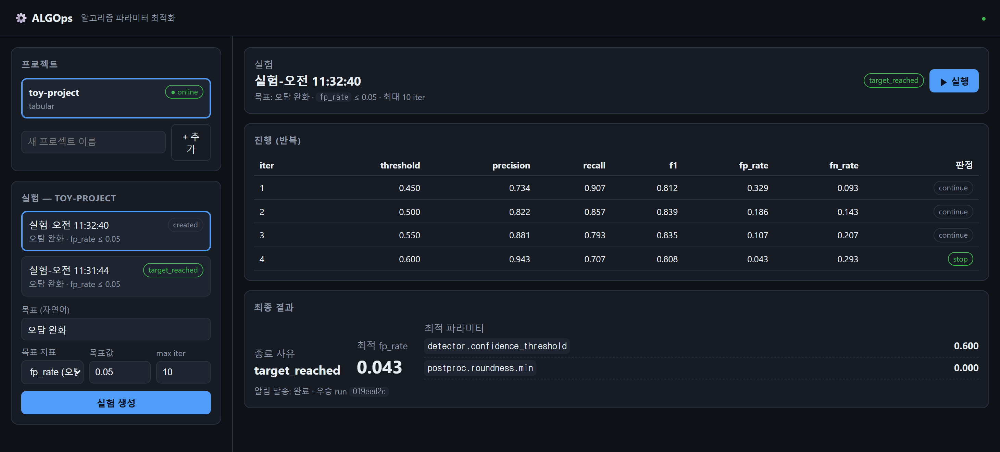
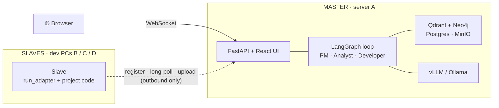
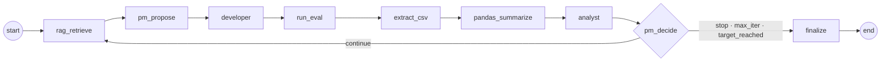
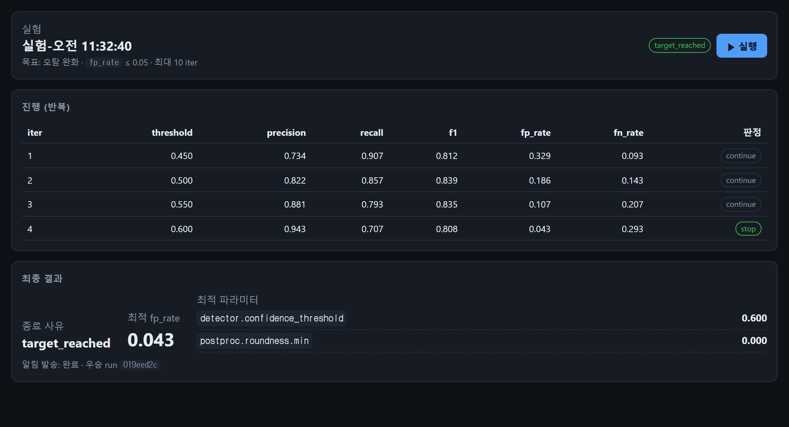

<div align="center">

# ⚙️ ALGOps

**RAG-based Algorithm Ops — let multi-agents tune your post-processing algorithm.**

[](https://www.python.org/)
[](https://github.com/langchain-ai/langgraph)
[](https://fastapi.tiangolo.com/)
[](https://react.dev/)
[](https://qdrant.tech/)
[](https://neo4j.com/)


[Quick Start](#-quick-start) · [How It Works](#️-how-it-works) · [The Loop](#-the-optimization-loop) · [Externalization](#-parameter-externalization-the-novel-core) · [Deployment](#-deployment) · [Roadmap](#️-roadmap)

<br/>



<sub>An experiment driving a detector's false-positive rate from 0.329 → 0.043 by searching its post-processing parameters. (UI is Korean — this is an on-prem tool for a Korean team.)</sub>

</div>

---

## 💡 What is ALGOps?

Classic MLOps (MLflow, W&B) tracks **training hyper-parameters → model performance**.

**ALGOps tracks the layer on top of the model** — the *post-processing algorithm parameters* that
wrap an AI model's raw output (confidence thresholds, shape/roundness filters, HSV/histogram
windowing, NMS modes, temporal smoothing …) — and **searches them automatically** with a team of
LLM agents and a RAG memory of past experiments.

You point an AI coding agent at your repo with *"install this and run ALGOps"*. Guided by a shipped
contract, it externalizes every scattered post-processing constant into one validated
`params.yaml`, then registers your project. From a web page you set a free-text goal
(e.g. *"reduce false positives"*), a target metric, and a max-iteration budget, and press **Run**.
A **LangGraph supervisor loop (PM → Analyst → Developer)** then proposes a parameter change,
evaluates it over your test set, analyzes the telemetry, consults what worked in past experiments,
and repeats — until the target is hit, the PM stops early, or the budget runs out. Every run is
tracked, reported, and remembered.

```
┌── classic MLOps ──────────────┐      ┌── ALGOps ─────────────────────────────────┐
│ training params → model perf  │  vs  │ post-processing params → optimal values    │
│ you tune + log manually       │      │ multi-agents + RAG tune them for you        │
└───────────────────────────────┘      └─────────────────────────────────────────────┘
```

> **Status: M0–M5 implemented.** Master/Slave + checkpointed LangGraph loop, multi-stage CSV
> telemetry, cross-experiment RAG memory, LLM agents, the coding-agent externalization contract,
> human-in-the-loop approval, and a full production stack. The **dev path runs with no external
> services or GPU** (in-memory RAG, SQLite, in-process loop, deterministic agents); production
> integrations switch on by config.

---

## ✨ Features

- 🧭 **Web-based, MLflow-like** — deploy once, browse projects / experiments / runs / live progress.
- 🛰️ **Master / Slave over your intranet** — one master on a server; one slave per project on dev
  PCs. Slaves are **outbound-only** (zero inbound ports — NAT/firewall friendly).
- 🤖 **Three-agent loop (PM · Analyst · Developer)** on LangGraph, with checkpointed resume and a
  router that *enforces* the iteration cap & target (an agent can never talk past them).
- 🧠 **RAG that learns across experiments** — each run's report → Qdrant; params, their FP/FN
  influence, and run lineage → Neo4j. "What lowered false positives last time?" is a query.
- 🔌 **Coding-agent externalization contract** — `AGENTS.md` / `CLAUDE.md` + a JSON Schema + an
  **executable verify gate** (behavior-preserving, not "the file exists").
- 📊 **Multi-stage telemetry** — one CSV per pipeline stage, joined on a stable `entity_id` spine,
  aggregated deterministically (no LLM code-execution / no RCE).
- 🔀 **Any OpenAI-compatible LLM** — vLLM (default) or Ollama; the same config struct, with a
  deterministic fallback so a flaky open model never crashes a campaign.
- 🙋 **Human-in-the-loop** — optionally pause for approval before each code change.
- 🔔 **Deterministic notifications** — Slack / email / console on completion (never via the LLM).

---

## 🏗️ How It Works

**Topology** — a durable master (server A) drives the loop; ephemeral slaves (dev PCs) own the code
and the test-set evaluation and only ever call *out* to the master.



**One run = one parameter-set evaluation.** The master mints a `run_id`, the slave evaluates it over
the test set and streams per-stage telemetry back. That `run_id` is the integrity spine across the
tracking DB, the CSVs, the vector store, and the graph.

---

## 🚀 Quick Start

No Docker, no GPU required for the dev path.

```bash
uv sync                 # virtualenv + dependencies
uv run algops-smoke     # in-process end-to-end demo (toy detector, SQLite, in-memory RAG)
uv run pytest           # 35 tests
```

Run the distributed flow locally (master + a slave, as in production):

```bash
# terminal 1 — master (serves the React UI)
uv run algops-master                         # http://127.0.0.1:8000

# terminal 2 — slave (bundled toy project)
ALGOPS_SLAVE_MASTER_URL=http://127.0.0.1:8000 uv run algops-slave
```

Open **http://127.0.0.1:8000** → the `toy-project` appears **online** → create an experiment
(goal, target metric, max iterations) → **Run** → watch iterations stream in and the final result
land.

### 🐳 Docker

```bash
docker compose -f deploy/docker-compose.dev.yml up --build      # master + toy slave, one command
```

---

## 🔁 The Optimization Loop

A LangGraph `StateGraph`. In M0 the agents are deterministic stubs (a single-parameter hill-climb);
from M1 the PM / Analyst / summarizer are real LLM agents behind the same node boundaries.



- **Stop is enforced in the router**, not the agent: `pm_action == stop` **OR** `iteration >= max`
  **OR** `target_reached`. The checkpointer keys on `thread_id = experiment_id`, so a worker
  restart resumes a campaign mid-flight.
- **`finalize`** writes the run report to Qdrant, upserts the graph in Neo4j, registers the optimal
  parameter set, and fires the deterministic notification.

<div align="center">

<br/><sub>Live iteration table and the final optimal parameter set.</sub>
</div>

---

## 🔌 Parameter Externalization (the novel core)

The entry point is: **give an AI coding agent (Claude Code / Codex) this repo's link and your
project**. It ships a deterministic contract and refactors your project — *without changing
behavior* — so ALGOps can sweep its parameters.

```bash
algops-init-contract .     # drop AGENTS.md / CLAUDE.md / params.schema.json + templates
algops-introspect .        # scan for hardcoded constants -> algops/UNDERSTANDING.md
# ... the coding agent writes algops/params.yaml + run_adapter.py ...
algops-verify .            # executable gate — must exit 0
```

Every parameter becomes a fully-specified object (so the PM can reason about it and the graph can
store it):

```yaml
params:
  - key: detector.confidence_threshold   # dotted, globally unique, IMMUTABLE
    dtype: float
    default: 0.45
    range: [0.05, 0.95]
    step: 0.05
    stage: decision                      # must match a CSV stage id
    influence: { fp: high, fn: high }    # a-priori FP/FN influence
```

The **verify gate checks behavior, not file existence**: params validate against the schema, the
loader imports cleanly, and `run_adapter.run()` returns a schema-valid result on a self-check —
enforce it with a Claude Code post-edit hook so the agent can't declare success otherwise.

---

## 🧠 Experiment Memory (RAG)

Experiments reference each other. *exp-a* has many misses → *exp-b* lowers the threshold → now too
many false positives → *exp-c* should recall the *a→b* lineage and what actually helped.

- **Qdrant** — each run's LLM/deterministic report is a chunked document (dense + sparse hybrid).
- **Neo4j** — `(:Run)-[:CHANGED]->(:Parameter)-[:INFLUENCES]->(:Metric)` + `DERIVED_FROM` lineage.
  `INFLUENCES.importance` is seeded from a-priori tags and **refined empirically** from observed
  metric deltas — this is the knowledge that makes later campaigns smarter.
- **Dev fallback** — an `InMemoryRagStore` gives the same retrieval + learned-influence behavior
  with zero external services (used by the tests).

---

## 🤖 LLM Backends

Everything reaches the model through the OpenAI-compatible `/v1` API, so *external vLLM*,
*external Ollama*, and *master-spun vLLM* are one config struct:

```bash
ALGOPS_MASTER_LLM__MODE=external
ALGOPS_MASTER_LLM__BASE_URL=http://<vllm-or-ollama>:8001/v1
ALGOPS_MASTER_LLM__MODEL=Qwen/Qwen3-8B-Instruct
```

vLLM is the default (enforced schema-valid output + can also serve the reranker); Ollama is the
small-GPU / dev fallback. `deploy/docker-compose.llm.yml` brings up a vLLM server.

---

## 📁 Project Structure

```
src/algops/
  core/         contracts: ids, enums, params, schemas, config (single source of truth)
  tracking/     SQLAlchemy models · session · artifact store · repositories
  extraction/   metric scoring · target checks · multi-stage CSV aggregation
  notify/       deterministic Slack / email / console (+ optional MCP)
  agents/       LangGraph loop (state · nodes · graph · executor · hooks)
  llm/          OpenAI-compatible client + LLM planner (PM/Analyst/summary)
  rag/          RagStore: in-memory (dev) + Qdrant/Neo4j (prod) + embed/rerank
  contract/     externalization bundle (AGENTS.md/CLAUDE.md/schema/templates) + verify gate
  master/       FastAPI control plane + experiment-loop worker + command bus + WS
  slave/        per-project agent: register · long-poll · run · upload (outbound only)
  toy_project/  bundled hand-externalized synthetic detector (the golden reference)
frontend/       React + TS + Vite Korean UI  (master serves the built dist at "/")
deploy/         Dockerfiles + docker-compose.{dev,master,slave,full,llm}.yml + traefik/
docs/           architecture.md · master-slave-protocol.md · deployment.md
```

---

## 🚢 Deployment

On-prem / intranet, multi-host. Master on a fixed-IP server; slaves on dev PCs connecting in.

```bash
# server A — full production stack (Postgres + Redis + MinIO + Qdrant + Neo4j + Celery + Traefik)
ALGOPS_ENROLL_TOKEN=<secret> docker compose -f deploy/docker-compose.full.yml up -d --build
# UI behind Traefik:  https://<A_IP>/

# each dev PC — one slave per project (outbound HTTP only)
ALGOPS_MASTER_URL=http://<A_IP>:8000 ALGOPS_PROJECT_NAME=proj-A \
  docker compose -f deploy/docker-compose.slave.yml up -d
```

In production the loop runs in a **Celery worker** (`dev_mode=false`) and talks to the API over a
Redis-backed command bus; durability is the **Postgres checkpoint**. Full details + GPU placement:
**[docs/deployment.md](docs/deployment.md)**.

---

## 🧪 Testing

```bash
uv run pytest             # 35 tests, ~15s, no external services
```

Covers contracts, scoring & router stop-conditions, the toy adapter (golden + determinism +
CSV↔metrics agreement), the full loop, **checkpoint resume**, **the real distributed master+slave
e2e**, the LLM-planner branch + fallback, RAG retrieval + cross-experiment memory, the
externalization gate, and the HITL approval gate.

---

## 🗺️ Roadmap

| Milestone | Scope | Status |
|---|---|---|
| **M0** | Master/Slave + checkpointed loop + CSV/metrics + notify, end-to-end | ✅ |
| **M1** | OpenAI-compatible LLM client + LLM planner (deterministic fallback) | ✅ |
| **M2** | Full multi-stage CSV convention + deterministic aggregation/sensitivity | ✅ |
| **M3** | Qdrant + Neo4j hybrid RAG (in-memory fallback) — cross-experiment memory | ✅ |
| **M4** | Coding-agent externalization contract + executable verify gate | ✅ |
| **M5** | S3/MinIO · Postgres · Redis bus · Celery · Traefik · React UI · HITL · MCP | ✅ |
| next | Worktree code-mutation for arbitrary repos · richer lineage UI · BFCL-tuned agents | ⏳ |

---

## 📜 License

Not yet specified — please open an issue or contact the maintainer before reuse.

<div align="center"><sub>Built with FastAPI · LangGraph · Qdrant · Neo4j · React. 🤖 Co-developed with Claude.</sub></div>
